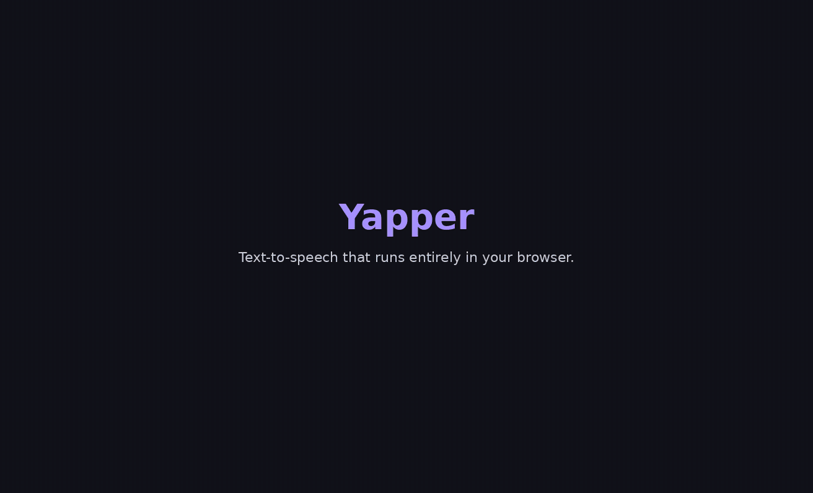

# Yapper 🔊

[](https://github.com/phantomic12/yapper/actions/workflows/ci.yml)
[](https://github.com/phantomic12/yapper/actions/workflows/e2e.yml)
[](https://github.com/phantomic12/yapper/actions/workflows/deploy.yml)
<!-- GPU-smoke badge — add back when the Kaggle workflow is reliably green:
[](https://github.com/phantomic12/yapper/actions/workflows/gpu-smoke.yml)
--->

**A private document reader that reads aloud — with zero cloud.** Drop a PDF, DOCX, EPUB, or any of a dozen formats into the reader; Yapper extracts the text on-device and reads it back with bookmarks, highlights, notes, and exports alongside. Kokoro, Kitten, and MMS-TTS voices run entirely in your browser. Yapper does no cloud processing and sends none of your text anywhere. Models load once, then everything runs locally on your device via WebGPU (or WASM fallback).

> **Note on performance:** Kokoro and Kitten are registered through `WorkerBackedEngine` (`src/engines/worker-bridge.ts` → `inference-worker.ts`), so load/generate for those models run off the main thread and the UI stays responsive while a job is in progress. MMS-TTS still runs on the main thread via Transformers.js — selecting one shows an in-app warning that generation may briefly freeze the page, and a liveness indicator runs in the queue while any job generates. The non-blocking queue lets you stack multiple jobs either way.

## Quick start

1. Open the [live demo](https://phantomic12.github.io/yapper/) (or run `npm run dev` locally). You land on the **Reader**.
2. Drop a PDF, DOCX, DOC, ODT, RTF, EPUB, XLSX, PPTX, CSV, HTML, TXT, or Markdown file — or press **Read a sample** to try it empty-handed. The document takes over the window under a top bar; **Quick read** speaks it with the browser voice, no model needed. For scanned PDFs, enable the OCR toggle (Tesseract or Florence-2 LLM).
3. For a better voice, open **Studio** and pick a **quality** — the default view asks for one word, not a model:
   - **Low** — fastest and smallest, 8 voices
   - **Medium** — the sweet spot: 28 selectable English voices (US + British, male + female)
   - **High** — best fidelity, same 28 voices (falls back automatically on GPUs without `shader-f16`)

   The model behind each preset starts downloading by itself, so there is no
   load button to press. It is cached after the first run. **Read aloud** on the
   reader bar then uses it; **Speak** on the Studio page reads pasted text.
4. Open **More** in the bottom bar for everything the short path leaves out:
   the full model grid, the language filter, download sizes, speed, and the
   per-model details behind each quality — Kokoro-82M in int8 (~88 MB) or fp16
   (~156 MB), Kitten TTS Mini (~78 MB) and Nano (~24 MB), and MMS-TTS (~50 MB
   each, 9 languages).

> A live demo (pick a model → load → queue a sample → audio plays):
>
> 
>
> MP4 version: [docs/demo.mp4](docs/demo.mp4) (1080p, better quality).
> Static stills: [landing](docs/demo-landing.png) · [audio playing](docs/demo-audio.png).
>
> _To regenerate the animated demo (`docs/demo.gif` + `docs/demo.mp4`): `python3 scripts/capture_demo_v3.py` from the project root (needs `playwright install chromium`, `numpy`, `pillow`, and `ffmpeg` on `PATH`). The script drives the live demo site, animates a real TTS flow, wraps frames in a fake browser chrome, and writes GIF/MP4 under `OUT_DIR` (default `./out` — copy into `docs/`). The "loaded" state may be synthesized in headless capture because large ONNX downloads + CORS can fail there; the real flow works in a normal browser._
>
> _Still screenshots only: `npm run demo:capture` runs `scripts/capture_demo.py` and writes PNGs to `scripts/demo-shots/`._

## Features

**The platform**

- **100% local inference** — text never leaves your browser
- **WebGPU acceleration** — GPU-accelerated when available, WASM fallback otherwise
- **A short path, and a long one** — the default view asks for a quality and a
  voice; the "More" toggle reveals the model grid, language filter, speeds and
  download sizes for anyone who wants them. Both views show the same truth, in
  different words
- **Models**
  - **Kokoro-82M** in int8 (~88 MB) and fp16 (~156 MB) — shared HF repo, different `modelFile` / dtype; 28 voices exposed in the picker
  - **Kitten TTS Mini** (~78 MB) and **Nano** (~24 MB) — 8 voices, ONNX Runtime Web
  - **MMS-TTS** (~50 MB each) — Meta's multilingual model for 9 languages (English, Spanish, French, German, Portuguese, Russian, Korean, Hindi, Arabic)
- **Off-thread Kokoro / Kitten** — `WorkerBackedEngine` keeps the page usable during those generations
- **Non-blocking queue** — stack multiple generations; finished clips persist in IndexedDB within a storage budget
- **The reader is the app** — it opens first, and an open document takes the
  whole window under a top bar (voice, view, position, close). Structure,
  bookmarks, highlights, notes and exports stay one tap beneath the pages

**Reading**

- **Read aloud** with a loaded model, or **Quick read** with the browser's own voice — before any model has downloaded
- **Pause, resume, stop** — the reading position is remembered per file
- **Silent reading** — the highlight advances at a reading pace with no synthesis and no audio
- **Reading unit** — word, line, sentence, or paragraph; skip forward and back by that unit
- **Dual highlighting** — the reading unit in one colour, the current word in another
- **Per-section voices** — give a paragraph or a selection a different voice; the page keeps its words
- **Pronunciation editor** — say-as rules (`word = say`) for names, acronyms and heteronyms, applied to the voice only
- **Reading themes** — light / sepia / night, serif / sans / mono, and a type-size control for reflowable documents or zoom for PDF pages
- **Keyboard shortcuts** with an in-app cheat sheet; single-key shortcuts can be switched off

**Documents**

- **Twelve formats** — PDF, DOCX, DOC, ODT, RTF, EPUB, XLSX, PPTX, CSV, HTML, TXT, MD (details below)
- **Real pages** — PDFs render from the file with page navigation, zoom and search; reflowable formats are flowed onto page sheets
- **OCR for scans** — Tesseract (fast, small WASM core) or Florence-2 (slower, larger download), chosen per document
- **OCR cleanup** — find/replace rules for recurring scanner mistakes, whole-word or infix, importable and exportable, plus repeating header/footer suppression
- **Select-to-read** — drag a box over part of a page and hear only that
- **Read a web page** by URL — the site has to allow it, and a refusal is reported as an error rather than a blank document
- **Recent documents** — a shelf of what was opened, showing how far each was read, plus search across every document opened this session
- **Document structure** — headings, paragraphs, lists, quotes, code and tables classified and listed, with an outline where the format has sections
- **Document search** — case-sensitive, whole-word and regex modes, with highlight-all
- **Document restrictions** — password-gated per-file limits on editing, copying, audio export, voice changes and opening another document; reading aloud is never restricted

**Study tools**

- **Bookmarks and colour highlights**, both with notes, both stored per file
- **Three-column notes** — an editable margin rail: the line from the page, and your note beside it
- **Self-test** — cover the notes or the cues, then reveal one card at a time
- **Prompt notes** — pin a question to a word or paragraph; a marker in the text opens the answer
- **Voice notes** — record, play and delete a spoken note at a spot (2 minutes max)
- **Test answers** — answer at a question spot and export a numbered test sheet with the question context
- **Word list and vocabulary study guide** — uncommon words ranked from the document, then a Markdown guide with syllables, senses and the sentence each came from
- **Review notes aloud** — highlights and bookmarks read back in document order, painted as they are spoken
- **Reading statistics** — position, word count and estimated reading time in the status bar

**Writing support**

- **A talking editor** — word prediction from a frequency list (Tab accepts the first), spell check with click-to-apply suggestions, speak-while-typing, and read-the-draft
- **Dictation** — on-device Whisper Tiny (41 MB, WASM) in Studio, push-to-talk; the Write page uses the browser's own recogniser
- **Drafts autosave** locally

**Export**

- **Documents** as Markdown, HTML or plain text; **notes** as Markdown
- **Audio** as a single WAV clip, every finished clip as one WAV, or an **audiobook zip**: merged WAV, WebVTT captions, a self-contained karaoke page, and a chapter track where the document has sections

**Accessibility and interface**

- **Dark mode** — light, dark, or follow the system
- **Keyboard accessible controls** — skip link, visible focus indicators, ARIA live regions on async status
- **Reduced motion** honoured
- **Blackout / whiteout** the screen for focus

See [docs/reading-capabilities.md](docs/reading-capabilities.md) for the full capability matrix, including what is deliberately not offered and why.

## Known limitations

- **Dictated email addresses and URLs need checking.** The on-device model is Whisper Tiny, and it merges spelled-out punctuation: "jordan dot lee at example dot com" can come out as `jordan.lea.example.com`. Read those fields back before sending. A larger checkpoint fixes it at roughly three times the download.
- **MP3 is not offered.** Every maintained in-browser MP3 encoder available to this project is a copyleft LAME or Shine port, and Yapper takes no copyleft dependency. Audio exports as WAV, so an audiobook is larger than an MP3 book would be.
- **Document restrictions are per file, not per content.** A restriction is keyed to the file's name, size and last-modified time; renaming or copying the file produces a different identity, and the copy is not restricted. It is a guard against casual circumvention, not a security boundary — the reader controls the browser and can remove the stored record.
- **The Write page's Dictate button is the browser's recogniser, not the on-device model.** On some browsers that audio goes to the browser vendor's service; the button's tooltip says so. Everything Yapper itself does with the resulting text stays in the tab. On-device dictation lives on the Studio page.

## Supported document formats

Active path: `src/document-reader.ts` → `src/reader.ts` (`DocumentReaderSession`).

| Format | Support | Notes |
|--------|---------|-------|
| PDF    | text + optional OCR | Text layer first; enable **Use OCR for scanned PDFs** for layout/OCR blocks |
| DOCX   | text | `word/document.xml` via JSZip |
| DOC    | text | Legacy Word format via binary text extraction (UTF-16LE/Latin-1 scan) |
| ODT    | text | Zipped ODF text extraction |
| RTF    | text | RTF control-word stripping to plain text |
| EPUB   | text | HTML spine text extraction |
| XLSX   | text | Spreadsheet cell text via JSZip |
| PPTX   | text | Presentation slide text via JSZip |
| CSV    | text | Comma-separated values parsed to rows |
| HTML   | text | HTML tag-stripped body text |
| TXT    | text | Plain UTF-8 |
| MD     | text | Read as text (markup left for the reader to handle lightly) |

PDF extraction is capped at 500 pages by default (`MAX_PDF_PAGES`) to avoid tab OOMs.

## Supported browsers

Verified in the automated cross-browser QA pass (2026-08-23) — see
[docs/qa-matrix.md](docs/qa-matrix.md) for the full matrix, timings, and raw results.

| Browser                          | Backend        | Result        | Notes                                                                  |
| -------------------------------- | -------------- | ------------- | ---------------------------------------------------------------------- |
| Chromium 151 / Chrome 124+       | WebGPU         | ✅ all checks | Model load + generation in single-digit seconds                        |
| Microsoft Edge 151               | WebGPU         | ✅ all checks |                                                                        |
| Firefox 153                      | WASM fallback  | ✅ all checks | First generation slower; later ones comparable                         |
| WebKitGTK 2.48                   | WASM fallback  | ✅ all checks | Closest available stand-in for Safari                                  |
| Chromium, mobile viewport        | WebGPU         | ✅ all checks | 390×844 (iPhone 13-class) viewport                                     |

Every column passes the same 7-step checklist: app loads, model select, download & load,
generate + audio, WAV download, document reader (TXT + PDF), clean console.
Real Safari (macOS/iOS) wasn't reachable from the QA host — WebKitGTK is the proxy;
other mobile viewports were not tested.

PDF extraction (pdfjs 6) additionally requires `Promise.try` — Chrome/Edge
128+, Firefox 134+, Safari 18.3+. Older engines can still use every other
format; the reader panel shows an explanatory message instead of a broken
spinner.

## Tech Stack

- [Transformers.js](https://huggingface.co/docs/transformers.js) — MMS-TTS, Florence-2 OCR, and Whisper dictation in the browser
- [ONNX Runtime Web](https://onnxruntime.ai) — WebGPU/WASM backend (Kitten; also used under Kokoro)
- Kokoro-82M runs on the app's own Transformers.js pipeline (phonemize → tokenize → StyleTTS2), not a wrapper package
- [pdfjs-dist](https://github.com/mozilla/pdf.js), [epubjs](https://github.com/futurepress/epub.js/), [jszip](https://github.com/Stuk/jszip), [fflate](https://github.com/101arrowz/fflate) — document parsing and archive building
- [tesseract.js](https://github.com/naptha/tesseract.js/) — client-side OCR (assets under `public/lib/tesseract/`)
- [hypher](https://github.com/bramstein/hypher) + `hyphenation.en-us` — syllabification
- [Vite](https://vitejs.dev) — build tooling
- TypeScript, vanilla CSS — no framework overhead

## Architecture (short)

| Module | Role |
|--------|------|
| `src/main.ts` | UI wiring, model registration, document upload |
| `src/engine.ts` | `TTSEngine`, `MODELS`, queue, WAV encode, speed |
| `src/engines/` | Kokoro, Kitten, `WorkerBackedEngine`, inference worker |
| `src/document-reader.ts` | File → plain text (+ optional PDF OCR layout blocks) |
| `src/reader.ts` | Reading session, chunking, sentence/word highlight |
| `src/events.ts` | Typed `engine.on()` lifecycle events |
| `public/sw.js` | App-shell PWA cache (not model weights) |

See [docs/architecture.md](docs/architecture.md) for a one-screen map.

## Development

```bash
npm install
npm run dev
```

Useful scripts: `npm test`, `npm run test:links`, `npm run lint`, `npm run typecheck`, `npm run build`.

### GPU testing

Unit tests + build + link-health (`npm test`, `npm run test:links`) run in CI on GitHub-hosted runners. The **GPU smoke test** goes further: on Kaggle's free GPU tier it launches headed Chromium over Xvfb and verifies **real WebGPU inference end-to-end** — `navigator.gpu` adapter available, model downloaded and loaded, and a full `generate()` round-trip that produces playable audio.

The workflow ([`.github/workflows/gpu-smoke.yml`](.github/workflows/gpu-smoke.yml)) pushes the kernel script to Kaggle via the official `kaggle` CLI, polls until the kernel finishes, downloads its output, and gates the run on `gpu-smoke-report.json`: green requires WebGPU available + model load done + generation done with positive audio duration. Anything else — including missing or broken credentials, or a skipped generation — fails loudly. The kernel always tests the ref that triggered the run (PR merge commit, release tag, or branch).

- Schedule: weekly, Sunday 06:00 UTC; also on release publish and manual dispatch
- Credentials: repo secret `KAGGLE_API_TOKEN` = raw contents of `kaggle.json` (`{"username": ..., "key": ...}`)
- Manual dispatch has a `break_token` input that corrupts the token on purpose, proving the run still fails loudly instead of skipping green
- Every run attaches its report JSON + probe screenshots as the `gpu-smoke-kaggle-output` artifact
- Kernel script: `.github/scripts/gpu_smoke_kaggle.py`

Local equivalent:

```bash
bash scripts/capture-gif.sh                                          # docker demo capture helper
docker run --rm --gpus all -v $(pwd)/out:/capture/out \
    --entrypoint python3 yapper-gif-capture \
    /capture/gpu_smoke_test.py --model kitten-nano                   # GPU probe
```

## Build

```bash
npm run build
# Output in dist/
```

## Privacy

- All text-to-speech inference and document parsing run **in your browser**
- Model files download from [Hugging Face](https://huggingface.co) and are cached locally
- OCR assets (worker, WASM core, `eng.traineddata`) ship under `public/lib/tesseract/` for on-device use
- **No analytics, no tracking, no server-side processing of your text**
- Uploaded files are read locally in the tab; they are not uploaded to a Yapper backend

## Document reading

1. Drop a file on the drop area (or click to browse). Max 25 MB in the UI.
2. Optionally enable **Use OCR for scanned PDFs** before extract.
3. Review extracted text in the reader view.
4. **Read document** queues chunks through the loaded model; the active sentence is highlighted as audio plays.

Unsupported types error clearly: PDF, DOCX, DOC, ODT, RTF, EPUB, XLSX, PPTX, CSV, HTML, TXT, MD only on the active path.

## License

MIT
